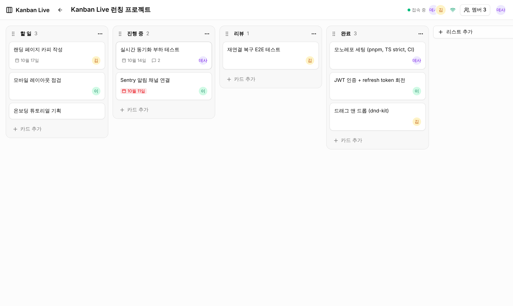
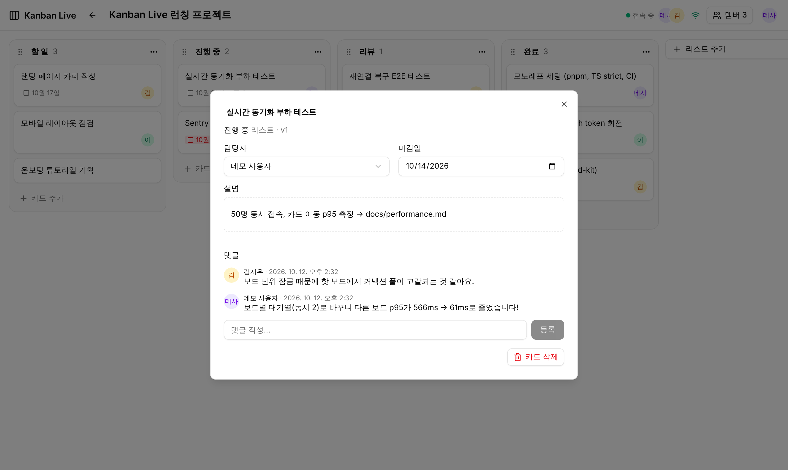
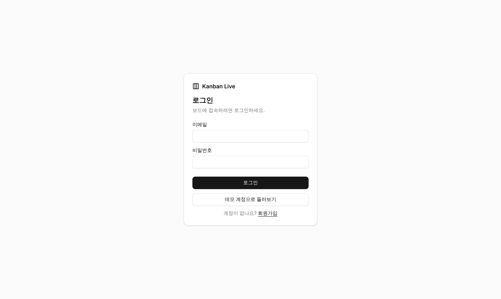

# Kanban Live

**여러 사람이 같은 보드를 동시에 편집하는 실시간 협업 칸반보드**

기능 개수보다 **"실시간 동기화 문제를 어떻게 풀었는가"** 에 집중한 풀스택 프로젝트입니다.
다루는 문제는 동시 이동 충돌, 낙관적 업데이트와 롤백, 재연결 시 누락 이벤트 복구, 다중 서버 수평 확장입니다.
각 문제를 테스트와 부하 측정으로 검증했습니다.

- **배포 URL**: _배포 후 추가_ (설정 방법: [docs/deployment.md](./docs/deployment.md))
- **데모 계정**: `demo@kanban.live` / `demo1234` (로그인 화면의 "데모 계정으로 둘러보기")
- **데모 GIF**: `docs/images/demo.gif` (브라우저 두 개로 동시 편집하는 장면을 녹화해 넣을 위치)



| 카드 상세 (담당자·마감일·댓글)              | 로그인 (데모 계정)                 |
| ------------------------------------------- | ---------------------------------- |
|  |  |

## 핵심 기술 도전

### 1. 동시 이동 충돌: "같은 자리에 두 카드가 동시에 들어오면?"

- 순서는 **문자열 fractional indexing**으로 저장합니다. 이동 1번에 행 1개만 갱신합니다.
- 최종 position은 **서버가 확정**합니다. 클라이언트는 앞/뒤 카드 id만 보내고, 서버가 잠금 안에서 실제 순서를 다시 읽어 계산합니다.
- 보드 행 잠금(`FOR UPDATE`) 안에서 Redis `INCR`로 seq를 발급합니다. 그래서 **커밋 순서 = 이벤트 순서**가 됩니다.
- 8개 카드를 같은 위치로 동시에 옮겨도 position이 모두 고유하고, 모든 클라이언트가 DB와 같은 상태로 수렴함을 테스트로 확인했습니다.
- 관련 문서: [ADR 002](./docs/decisions/002-fractional-indexing.md), [ADR 003](./docs/decisions/003-board-write-serialization.md)

### 2. 낙관적 업데이트 + 서버 확정 + 롤백

- 드롭 즉시 UI에 반영합니다. 서버 응답이나 이벤트(version+1)가 오면 확정하고, 실패하면 롤백하고 토스트를 띄웁니다.
- 이벤트 리듀서(`applyBoardEvent`)는 **version이 더 클 때만** 반영합니다. 그래서 응답과 브로드캐스트가 어떤 순서로 와도 같은 결과로 수렴합니다.
- 동시 수정은 `expectedVersion`으로 감지합니다(409). E2E로 "충돌 후에도 거절된 내 수정이 화면에 남는" 버그를 찾아 고쳤습니다 ([troubleshooting #5](./docs/troubleshooting.md)).

### 3. 재연결 복구

- 클라이언트는 마지막으로 처리한 seq를 보관하고, 재연결 시 `sync { lastSeq }`를 보냅니다.
- 서버는 Redis(Sorted Set)의 최근 이벤트를 다시 보내고, 범위를 벗어났으면 **전체 스냅샷**을 보냅니다.
- Playwright `setOffline`으로 끊긴 동안의 생성·이동·이름 변경이 복구되는지 검증했습니다.
- 관련 문서: [ADR 006](./docs/decisions/006-reconnect-and-scale-out.md)

### 4. 수평 확장과 성능

- Socket.IO **Redis adapter**를 씁니다. 서로 다른 서버에 붙은 사용자끼리도 동기화됩니다(api 2대 + Nginx, CI에서도 2대로 E2E 실행).
- 부하 테스트로 **커넥션 풀 고갈** 병목을 찾았습니다. 보드별 쓰기 대기열을 넣어 다른 보드의 이동 p95를 **564ms → 61ms**로 줄였습니다.
- 관련 문서: [performance.md](./docs/performance.md), [ADR 007](./docs/decisions/007-board-write-queue.md)

| 부하 테스트 (30초, 에러 0%, 전 클라이언트 수렴)  | 개선 전 | 개선 후    |
| ------------------------------------------------ | ------- | ---------- |
| 10개 보드 × 5명, 200 moves/s: 이동 p95           | 95.7ms  | **72.3ms** |
| 핫 보드(+40명) 상황에서 **다른 보드**의 이동 p95 | 564.6ms | **61.0ms** |
| 핫 보드 상황 전체 처리량                         | 175/s   | **245/s**  |
| `/login` 초기 JS (gzip)                          | 214KB   | **152KB**  |

## 기술 스택

| 영역       | 스택                                                                                           |
| ---------- | ---------------------------------------------------------------------------------------------- |
| 프론트엔드 | React 19, TypeScript, Vite 8, TanStack Query, Zustand, dnd-kit, Tailwind CSS v4, **shadcn/ui** |
| 백엔드     | NestJS 11, Socket.IO (+ Redis adapter), Prisma 6, class-validator, Swagger                     |
| 데이터     | PostgreSQL 16, Redis 7 (seq · 이벤트 로그 · Pub/Sub)                                           |
| 인증       | JWT access(메모리) + 회전 refresh token(httpOnly 쿠키), bcrypt                                 |
| 테스트     | Vitest, Jest, Supertest, socket.io-client, **Playwright(브라우저 2개)**, 자체 부하 테스트      |
| 운영       | Docker(단일 이미지), docker-compose(확장 구성 포함), GitHub Actions, Fly.io, pino, Sentry      |

구조와 다이어그램(시스템 구성도, ERD, 카드 이동/재연결 시퀀스)은 [docs/architecture.md](./docs/architecture.md)에 있습니다.

```
apps/api        NestJS API + Socket.IO 게이트웨이
apps/web        React SPA (shadcn/ui)
packages/shared api·web 공유 타입, fractional indexing, 순서 계산, 이벤트 리듀서
e2e/            Playwright E2E
load/           부하 테스트
docs/           아키텍처 · ADR · 트러블슈팅 · 성능 · 배포
```

## 로컬 실행 (5분)

필요한 것: **Node.js 22**, **pnpm 10**(`corepack enable`), **Docker**

```bash
# 1) 의존성 + 환경 변수
corepack enable
pnpm install
cp apps/api/.env.example apps/api/.env

# 2) PostgreSQL · Redis
docker compose up -d

# 3) DB 마이그레이션 + 데모 데이터
pnpm --filter @kanban/api prisma:deploy
pnpm build && pnpm --filter @kanban/api seed

# 4) 개발 서버 (api :3000, web :5173)
pnpm dev
```

<http://localhost:5173>에 접속해 **데모 계정으로 둘러보기**를 누르세요.
다른 브라우저(또는 시크릿 창)에서 `jiwoo@kanban.live` / `demo1234`로 로그인하면 실시간 동기화와 접속자 표시를 볼 수 있습니다.
API 문서(Swagger)는 <http://localhost:3000/docs>에 있습니다.

### 컨테이너로 실행

```bash
# 앱 1대 (http://localhost:3000)
docker compose --profile app up --build

# api 2대 + Nginx 로드밸런서 (http://localhost:8080)
docker compose -f docker-compose.yml -f docker-compose.scale.yml --profile scale up --build
```

## 테스트

| 명령                                      | 내용                                                                                        | 개수 |
| ----------------------------------------- | ------------------------------------------------------------------------------------------- | ---- |
| `pnpm test`                               | 단위 테스트: fractional indexing, 순서 계산, 리듀서/시퀀서, 권한, 낙관적 업데이트, 세마포어 | 66   |
| `pnpm --filter @kanban/api test:e2e`      | 실제 DB/Redis: 인증·CRUD·권한, 소켓, **동시성**, **멀티 인스턴스**                          | 46   |
| `pnpm --filter @kanban/e2e test:e2e`      | Playwright: 드래그, 2개 브라우저 동기화, 롤백, 충돌, **끊김/복구**, 뷰어 권한, 멀티 서버    | 8    |
| `pnpm --filter @kanban/load move-latency` | 부하 테스트 (환경 변수로 시나리오 설정, [performance.md](./docs/performance.md))            |      |

E2E 실행 방법

- 서버가 떠 있는 상태(`pnpm dev`)에서 `pnpm --filter @kanban/e2e test:e2e`를 실행합니다.
- CI에서는 `E2E_START_SERVER=1`로 api 2대를 직접 띄웁니다.

CI(GitHub Actions)는 푸시마다 포맷 → 린트 → 타입체크 → 단위 테스트 → 빌드 → API e2e → Playwright E2E를 실행하고, `main`이면 Fly.io로 배포합니다.

## 스크립트

| 명령                             | 설명                                        |
| -------------------------------- | ------------------------------------------- |
| `pnpm dev`                       | shared 빌드 후 api·web 개발 서버            |
| `pnpm build`                     | 전체 빌드                                   |
| `pnpm lint` / `pnpm format`      | ESLint / Prettier                           |
| `pnpm typecheck`                 | 전체 타입체크 (TypeScript strict)           |
| `pnpm --filter @kanban/api seed` | 데모 데이터 (`SEED_RESET=true`면 다시 생성) |

## 문서

- [docs/architecture.md](./docs/architecture.md): 시스템 구성도, ERD, 시퀀스 다이어그램, 정합성 규칙
- [docs/decisions/](./docs/decisions): 기술 결정 기록(ADR) 8건
- [docs/troubleshooting.md](./docs/troubleshooting.md): 문제 → 원인 → 해결 → 결과 10건
- [docs/performance.md](./docs/performance.md): 부하 테스트 방법, 병목 분석, 개선 전후 수치
- [docs/deployment.md](./docs/deployment.md): Fly.io 배포, 환경 변수
- [CLAUDE.md](./CLAUDE.md): 프로젝트 명세와 개발 규칙
