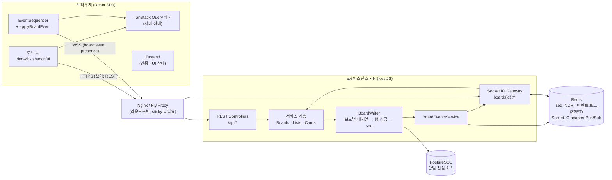
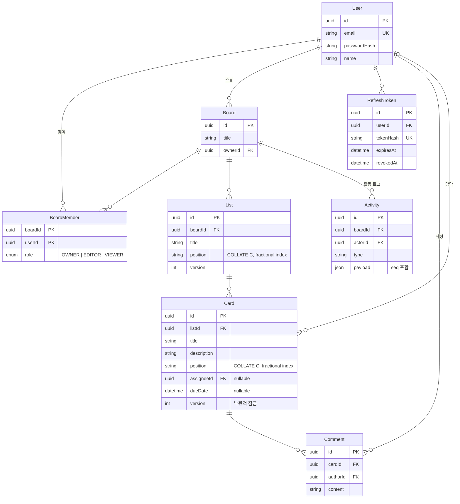
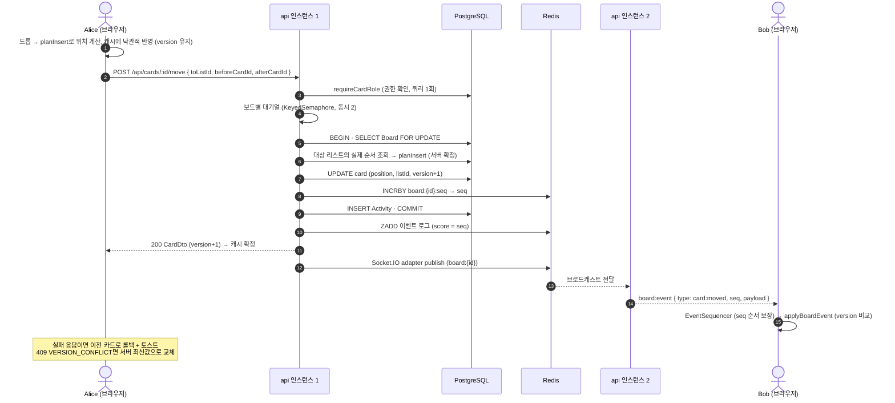
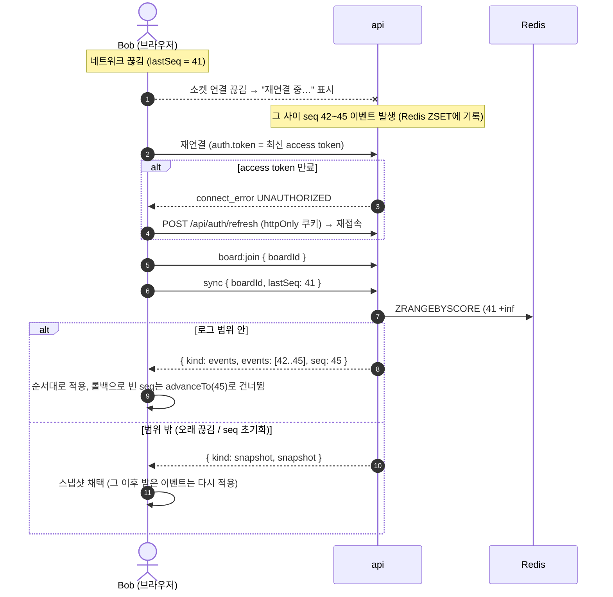

# 아키텍처

## 1. 시스템 구성



- **쓰기**: 클라이언트는 REST로 변경을 요청한다. 소켓의 `card:move` 같은 쓰기 이벤트도 같은 서비스 계층을 호출한다.
- **읽기 동기화**: 서버는 커밋 후 `board:event`(seq 포함)를 룸으로 브로드캐스트한다. 클라이언트는 seq 순서대로 캐시에 반영한다.
- **수평 확장**: Socket.IO Redis adapter가 인스턴스 간 브로드캐스트와 `fetchSockets`(presence)를 공유한다. seq는 Redis `INCRBY`로 발급하므로 인스턴스와 무관하게 단조 증가한다.
- **배포**: 단일 이미지. api가 web 정적 파일도 서빙해 같은 오리진을 쓰므로 쿠키/CORS 설정이 단순하다.

## 2. 모노레포 구조

```
apps/
  api/            NestJS 11 · Prisma 6 · Socket.IO
    src/auth        JWT access + 회전 refresh token(httpOnly 쿠키)
    src/boards      보드/멤버, BoardAccessService(권한 검사)
    src/lists       리스트 CRUD/이동
    src/cards       카드 CRUD/이동/댓글
    src/common      BoardWriter(쓰기 골격), KeyedSemaphore, 에러 필터, 로깅
    src/events      seq 발급 · Redis 이벤트 로그 · 발행
    src/realtime    Socket.IO 게이트웨이, Redis adapter
    test/           실제 PostgreSQL/Redis e2e (REST · 소켓 · 동시성 · 멀티 인스턴스)
  web/            React 19 · Vite · TanStack Query · Zustand · dnd-kit · shadcn/ui
    src/features/board   보드 캔버스, 낙관적 업데이트, 실시간 훅
packages/
  shared/         api·web 공유: 도메인/이벤트 타입, fractional indexing,
                  planInsert(순서 계산), applyBoardEvent(리듀서), EventSequencer
e2e/              Playwright (브라우저 2개 · 끊김/복구 · 권한 · 멀티 서버)
load/             카드 이동 부하 테스트 (요청/전파 지연, 수렴 검증)
```

순서 계산(`planInsert`)과 이벤트 리듀서(`applyBoardEvent`)를 **서버와 클라이언트가 같은 코드로** 쓰는 것이 핵심이다.
낙관적 업데이트 결과가 서버 확정 결과와 대부분 일치하고, 수렴성은 순수 함수 단위 테스트로 검증한다.

## 3. 데이터 모델 (ERD)



인덱스: `Card(listId, position)`, `List(boardId, position)`, `Activity(boardId, createdAt)`, `BoardMember(userId)`, `Comment(cardId, createdAt)`

## 4. 카드 이동 시퀀스



## 5. 재연결 복구 시퀀스



## 6. 정합성 규칙 요약

| 규칙                                                                 | 구현 위치                                          |
| -------------------------------------------------------------------- | -------------------------------------------------- |
| 쓰기의 단일 진실 소스는 DB, 최종 position은 서버가 확정              | `CardsService.move` → `planInsert`                 |
| 같은 보드의 쓰기는 직렬화 (position 중복 방지, seq 순서 = 커밋 순서) | `BoardWriter` (대기열 + `FOR UPDATE`)              |
| 스냅샷과 이벤트의 경계가 정확히 맞음                                 | `BoardsService.snapshot` (`FOR SHARE` 후 seq 읽기) |
| 이벤트 적용은 version이 더 클 때만 → 멱등, 순서 무관 수렴            | `applyBoardEvent` / `upsertCard`                   |
| 서버 확정 응답(409 current)은 같은 version이어도 채택                | `upsertCard(…, authoritative)`                     |
| seq 공백 → 잠시 대기 후 sync, 롤백 공백은 건너뜀                     | `EventSequencer`, `useBoardRealtime`               |
| 권한은 REST·소켓 모두 매 요청 DB로 확인, 역할 변경은 즉시 반영       | `BoardAccessService`, `member:*` 이벤트            |
